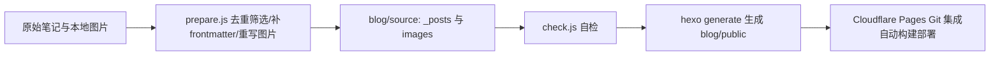

## 产品概述

把当前 Typora 笔记仓库改造成一个上线的个人博客，站点风格为博客型（首页文章列表、时间线、标签、分类），全部采用完全免费的方案，不购买域名、不使用付费图床。部署改用 Cloudflare Pages，站点静态资源不依赖国内访问不稳定的海外 CDN。

## 核心功能

- 博客型首页：文章卡片列表、最新文章、标签云、分类、归档时间线
- 只发布去重后的主笔记，跳过 `_local`、`(copy)`、`副本` 等重复文件以及 MCP 项目运行产物
- 所有图片本地化：把已失效的阿里云 OSS 外链替换为仓库内已有的本地图片，第三方外链图片尽量下载，失败则移除并记录清单
- 自动生成 frontmatter（标题、日期、分类、标签），让 Hexo 能正确组织文章
- 原始笔记不改动、不移动，用户仍可用 Typora 正常编辑
- 通过 Cloudflare Pages 原生 Git 集成免费部署，push 到 main 自动构建上线
- 构建自检：确认生成的站点中无残留 OSS 链接、引用的图片文件全部存在
- 前端资源国内友好：主题所需 JS/CSS/字体优先本地化，禁用 Google Fonts / jsdelivr / unpkg 等国内不稳定源，第三方库统一走 npmmirror（registry.npmmirror.com）

## 关键约束

- 完全免费：开源 Hexo 主题、Cloudflare Pages 免费额度，不买域名、不用付费图床
- 仓库已约 410MB，构建期生成的文章与图片不入库，避免体积翻倍
- 所有技术与资源以国内可稳定访问为准：构建在 Cloudflare 云端完成，站点资源随构建产物一起发布，不依赖运行时海外 CDN
- 上线后需验证首页、文章页图片正常显示，无外链残留

## 技术栈选型

- 静态博客引擎：Hexo（Node.js），本地与 Cloudflare Pages 构建均固定 Node 20
- 主题：免费开源中文友好主题 `hexo-theme-butterfly`（自带首页列表、标签页、分类页、归档页、深色模式、代码高亮、图片灯箱），通过 npm 依赖安装
- 部署：Cloudflare Pages 原生 Git 集成（连接 GitHub 仓库 `ltpbje/my_note`），无需 GitHub Actions、无需额外 token
- Root directory：`blog`
- Build command：`npm ci && npm run prepare && npm run check && npx hexo generate`
- Build output：`public`
- 环境变量：`NODE_VERSION=20`
- 站点根路径 `/`，访问地址形如 `https://my-note.pages.dev`（项目名决定子域名），不启用自定义域名
- 无新增运行时依赖：构建脚本只用 Node 内置模块 fs/path/crypto，自检用 assert，不引入测试框架
- 中文字体使用系统字体栈（Noto Sans SC / PingFang SC / Microsoft YaHei），不从 Google Fonts 加载

## 实现思路与关键决策

采用「构建期生成」策略：保留原笔记为唯一真实来源，用一个 prepare 脚本在构建时完成四件事——筛选去重主笔记、补 frontmatter、把 OSS/本地图片链接统一重写为站内路径、仅复制被引用的本地图片到站点 source/images。Hexo 生成静态站后由 Cloudflare Pages 发布。

关键决策与取舍：

- 主笔记的 OSS 图片实测已返回 404，因此对每个主题优先选用其「本地图片版兄弟文件」作为内容源（两者正文基本一致），这样既满足「发布正式版」，又天然获得可用图片；无兄弟文件的个别笔记按 alt 文本匹配本地图片。
- 图片只在构建期复制且被 gitignore，原始图片在仓库中仅存一份，仓库维持在约 410MB，规避 GitHub 1GB 软限制。
- 文章用 ASCII 文件名生成稳定短链，中文标题放 frontmatter，避免中文目录 URL 编码问题。
- 自检放在 `hexo generate` 之前对生成的源内容校验，并在构建命令中串联，发现缺失图片或残留 OSS 链接直接让 Cloudflare 构建失败，防止静默产出坏站。
- 部署选 Cloudflare Pages 原生 Git 集成而非 GitHub Actions：少一个 workflow 文件、少一套 token 配置，且用户明确要求 Cloudflare 方案。

性能与可靠性：prepare 扫描约 52 个 md 和约 2100 张图片，时间复杂度 O(N)，瓶颈是 CI 中复制被引用的图片，缓解方式是只复制被文章实际引用的图片并按内容哈希去重，重复图片不重复复制。

## 实现注意事项

- 不移动、不重命名任何原始笔记目录；所有新代码集中在 `blog/`，保持 git 历史与现有工作流不受影响。
- `blog/source/_posts`、`blog/source/images`、`blog/public`、`blog/node_modules` 全部加入 `.gitignore`。
- 第三方外链图片（如 img.smyhvae.com、cn.vuejs.org）在 prepare 中尝试下载到本地，失败则移除链接并写入缺失清单，用 ponytail 注释标注该降级的边界与后续补图方案。
- 图片按 basename/alt 匹配属启发式，存在同名误配风险，用 ponytail 注释标注上限，升级路径是维护显式映射表。
- Butterfly 主题默认从海外 CDN 加载第三方库，需在 `_config.butterfly.yml` 中关闭或替换：优先把主题所需资源复制到 `blog/source/` 随站点发布；无法本地化的（如字体图标）改走 `https://registry.npmmirror.com`。用 ponytail 注释标注哪些资源走国内镜像。
- 若 npm 主题未被 Hexo 自动解析，在 package.json 的 postinstall 中把 node_modules 里的主题复制到 `blog/themes/butterfly` 作为兜底。
- 日志只输出缺失图片清单与计数，不打印大段正文或敏感信息。

## 架构设计



数据流：原始笔记（只读）经 prepare 生成站点源内容与图片引用，自检通过后由 Hexo 编译为静态 HTML，push 到 main 触发 Cloudflare Pages 构建并发布。原笔记与站点产物完全解耦。

## 目录结构（全部为新增，原始笔记目录保持不动）

```
notes/
├── blog/
│   ├── package.json              # [NEW] hexo init 标准依赖 + hexo-theme-butterfly + prepare/build/check 脚本 + postinstall 兜底
│   ├── _config.yml               # [NEW] Hexo 主配置：root=/、theme=butterfly、ASCII 短链、站点标题与描述
│   ├── _config.butterfly.yml     # [NEW] 主题配置：首页卡片列表、标签/分类/归档页、深色模式、代码高亮、图片灯箱、资源本地化或走 npmmirror
│   ├── .gitignore                # [NEW] 忽略 node_modules、public、source/_posts、source/images
│   └── scripts/
│       ├── prepare.js            # [NEW] 筛选去重主笔记、补 frontmatter、重写图片链接、按哈希去重复制本地图、下载第三方图失败则移除并记清单
│       └── check.js              # [NEW] 扫描生成的源内容，断言无 OSS 残留且图片齐全，输出缺失清单并以非零码退出
└── README.md                     # [NEW] 新增笔记命名约定、本地预览命令、Cloudflare Pages 上线步骤（Root directory / Build command / output / NODE_VERSION）、已知图片降级清单查看方式
```

## 关键说明

- frontmatter 的 date 取文件 mtime，categories 取顶层目录名，tags 取次级目录或文件夹名，title 取首个一级标题或文件名。
- 图片重写后写入形如 `/images/<hash>.<ext>` 的路径，Hexo 结合 root=`/` 输出为 `/images/<hash>.<ext>`，适配 Cloudflare Pages 根路径。
- Cloudflare Pages 构建命令串联 `npm run prepare && npm run check && npx hexo generate`，任一步失败即中止部署。
- 用户需在 Cloudflare 控制台连接 GitHub 仓库并按上述构建设置创建 Pages 项目，后续 push 自动部署；无需配置 GitHub Actions 权限。

## 设计风格

基于 Hexo + Butterfly 主题打造现代技术博客视觉：整体为「清爽卡片式 + 深色模式」，首页以大幅渐变头图与博主简介开场，下方是文章卡片网格，悬浮时轻微上浮与阴影加深；代码与图片阅读体验优先，代码块带语法高亮与复制按钮，图片支持灯箱放大。全站响应式，桌面三栏（导航/正文/目录）与移动单栏自适应，配阅读进度条与平滑滚动微动效，专业且有质感。中文字体使用系统字体栈，避免海外字体源导致的加载失败或延迟。

## 页面与区块（共 5 页，每页含顶部导航与底部信息栏）

1. 首页：顶部导航（首页/标签/分类/归档/关于+搜索+深色切换）、渐变 Hero 博主介绍、文章卡片列表、侧边标签云与最新文章、底部版权与 GitHub 链接。
2. 归档页：顶部导航、归档标题与年份分组、时间线卡片列表、按年折叠、底部栏。
3. 标签页：顶部导航、标签云（字号随文章数变化）、标签筛选后的文章列表、底部栏。
4. 分类页：顶部导航、分类卡片网格（按技术方向分组）、分类下文章计数、底部栏。
5. 文章页：顶部导航、面包屑与标题元信息、正文排版区（代码高亮/图片灯箱/引用样式）、右侧目录 TOC、上一篇下一篇与标签、评论区占位、底部栏。